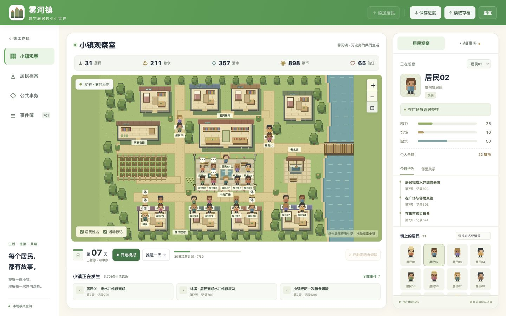

# 雾河镇：数字居民小镇模拟系统

一个中文像素小镇观察室：看居民生活、交往和作出公共选择，并用事件与存档解释、复现变化。



**MVP1、最新中文桌面界面、测试与交付文档已于2026-11-19全部合入 main。44项本地测试通过，合并版本的 GitHub Actions 检查通过。**

## 本地运行
需要 Python 3；测试另需 Node.js 22+。无运行时第三方依赖，无需执行 npm install。

```sh
npm start
# 打开 http://127.0.0.1:8765/src/index.html
npm test
npm run docs:check
```

首次打开自动创建30名居民并暂停。可以添加1名授权虚构人物，推进七天，触发粮食短缺，在“小镇事务”中关闭投票并维修水井，再保存/读取进度。刷新前请保存，当前没有自动存档。

## 已实现内容
- 中文原创像素地图、居民观察、关系和行为记录、事件筛选，支持地图缩放和平移。
- 固定种子与原子日结算：工作、工资、食水消费、休息、社交及资金守恒。
- 人物授权/大小/格式校验，投票、维修、重复执行保护。
- 完整快照与拒绝校验；第15日恢复后继续运行，与连续30日结果一致。

面向电脑端，验证尺寸1440×900、1280×720。参考Smallville的观察方式，场景与像素绘制为本项目原创；[设计说明](docs/frontend-design.md)解释呈现边界。模型对话、路径寻路、账号/云同步不在当前范围。

## 工程与课程导航
| 内容 | 入口 |
| --- | --- |
| 实现结果与原始证据 | [验收记录](docs/test/implementation-results.md)、[工程进度与合并记录](docs/engineering-progress.md) |
| 06 上下文与协作 | [context](context.md)、[AI规则](agent-rules.md)、[团队安排](docs/team-guide.md) |
| 07 Spec与验收 | [范围](spec/mvp1-scope.md)、[五模块Spec](spec/README.md)、[独立冷启动记录](docs/test/cold-start-01.md) |
| 08 架构与决策 | [架构](docs/architecture.md)、[ADR-001](adr/ADR-001-runtime-and-state.md)、[ADR-002](adr/ADR-002-atomicity-and-replay.md)、[风险](docs/dependency.md) |
| 09 任务与评审 | [12项Plan](plans/mvp1-plan.md)、[真实Issue](plans/issues/README.md)、[PR准入](docs/review/pr-checklist.md) |
| 逐项交付核对 | [PDF与模板检查表](docs/delivery-checklist.md)、[追踪矩阵](docs/traceability.md)、[GitHub交付](docs/github-delivery.md) |

[工程看板](https://github.com/users/techcswang-cpu/projects/1)由当前协作者持有，当前为私有；访问以账号权限为准。测试通过不代替非作者人工评审和ADR接受。

## 首次阅读路径

先读[项目上下文](context.md)，再看[MVP1范围](spec/mvp1-scope.md)、[系统架构](docs/architecture.md)与[任务计划](plans/mvp1-plan.md)，最后用[交付检查表](docs/delivery-checklist.md)核对课程要求。

## 目录与历史
`src/`为正式源码，`tests/`为自动化测试，`spec/`、`adr/`、`plans/`为工程契约，`docs/test/evidence/`保存真实运行证据。

原文档基线保留在提交03c9856。[历史HTML探针](docs/spike/town-simulation-spike.md)与[旧冷启动记录](docs/test/cold-start-2026-11-10-history.md)仅作为历史材料，不作为新实现验收证据。
