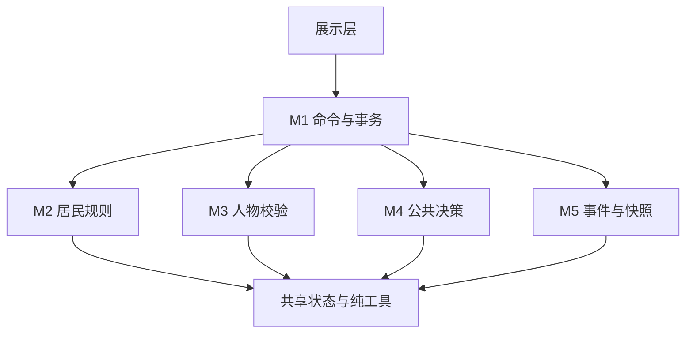
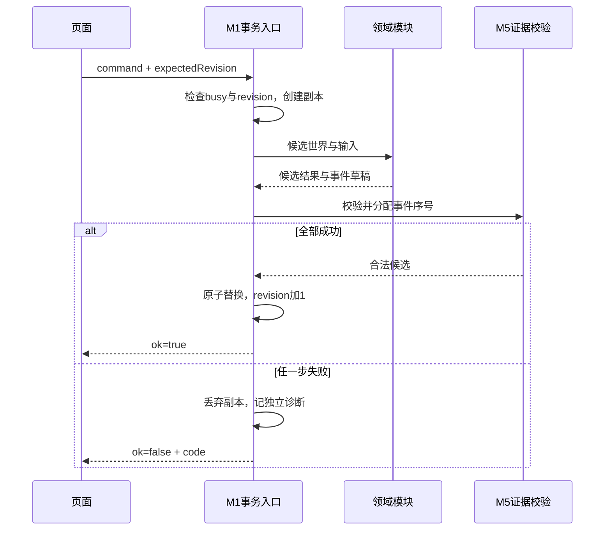

# 雾河镇 MVP1 架构基线

> 第8周交付；v2.0；2026-11-18。供团队评审的具体建议基线；不声称已有人工作出接受决议。

## 1. 范围与技术选择
五模块与 [scope](../spec/mvp1-scope.md) 一致。采用本地浏览器单实例、ES modules、内存世界、JSON快照。部署形态是静态页面；没有HTTP业务API，因此不套用图书借阅模板的201/409。模块API使用Result和稳定错误码。后端不是遗漏，而是本版明确的Non-Goal。备选见 [ADR-001](../adr/ADR-001-runtime-and-state.md)。

## 2. 分层与模块边界
| 层/模块 | 责任 | 不负责 | 计划目录 |
| --- | --- | --- | --- |
| 展示层 | 表单、总览、详情、事件、错误反馈 | 不算余额/票数、不直接改state | src/ui/ |
| 应用层 M1 | 命令分发、暂停/调度、revision、事务提交 | 不重新实现M2–M5规则 | src/app/ |
| 领域 M2 | 日生活、生产消费、关系 | 不渲染、不存储 | src/domain/life.mjs |
| 领域 M3 | 人物校验、候选居民 | 不请求外部画像 | src/domain/profile.mjs |
| 领域 M4 | 立场、计票、一次执行 | 不越过公库约束 | src/domain/decision.mjs |
| 证据 M5 | 事件构建、快照编码校验 | 不调用UI或推进时间 | src/evidence/ |
| 共享契约 | 类型约束、常量、PRNG、场景 | 不依赖上层业务 | src/shared/ |

2026-11-18用户授权进入实现阶段，以上目录成为正式模块文件白名单。ADR仍待人工评审，代码和测试是评审证据。

## 3. 依赖方向


M2/M3/M4输出事件草稿，M1交M5分配序号并原子提交；领域模块不反向调用M1，M5不回调领域模块。不把“用户先导入后投票”的操作顺序误画成代码循环依赖。

## 4. 共享数据模型
| 对象 | 必要字段与约束 |
| --- | --- |
| Runtime（不序列化） | paused=true起步、busy=false、runtimeRevision单调增加、diagnostics |
| Snapshot | schemaVersion=1、ruleVersion=1、scenarioVersion=1、seed、rngState、state、events |
| WorldState | day≥0、agents、facilities、resources、communityTrust、proposal、shortageApplied、externalSpent、nextEventSequence |
| Agent | agentId、displayName、sourceType、jobCode、homeFacilityId、energy/hunger/waterNeed 0..100、cash≥0、relationships、profile（仅数字人物） |
| Resources | food=180、water=180、wood=100、treasury=1000初始化；均非负安全整数 |
| Facility | facilityId、type、open、capacity；farm/well/market/plaza/home五类；住宅容量31、广场容量10 |
| Proposal | 固定ID、version1、OPEN/APPROVED/REJECTED/EXECUTED、cost120、effects、proposer、ballots |
| Ballot | agentId、waterNeed、communityTrust、affinity、score10、support、ruleVersion |
| Event | eventId、sequence、day、type、actorIds、targetIds、ruleVersion、reason、effects、causedBy |

Event.effects为`[{entityId,field,before,after}]`。actorIds只引用居民；targetIds引用居民/设施/议案或固定`town`；初始化事件允许空actorIds。每张票唯一引用在册居民；MVP1不支持单人删除，因此快照无历史悬空人物引用。

默认数据与字段约束见 [演示配置](fixtures/scenario-v1.json) 和 [数据契约](contracts/data-contract.md)。配置中的初始人口和资源不是自由UI编辑项；改值需换场景版本或测试夹具。

## 5. 接口契约
统一类型：
```text
Result<T> = { ok: true, data: T, events: Event[] }
          | { ok: false, error: { code: string, message: string }, events: [] }
```
Result是本地函数返回值，不假装HTTP响应。所有改变世界的入口都走`dispatch({type,payload,expectedRevision})`。busy优先于revision校验；初次createWorld/importSnapshot允许没有世界，其余要求已初始化。调用成功的返回值由下表决定；错误码以五份Spec为准。

| 操作 | 输入payload | 成功data | 失败 |
| --- | --- | --- | --- |
| CREATE_WORLD | `{config}` | `{day:0,agentCount:30,revision}` | SCENARIO_CONFIG_INVALID / SCENARIO_VERSION_UNSUPPORTED |
| STEP | `{}` | `{day,revision,eventIds}` | STEP_IN_PROGRESS / STATE_CONFLICT / STEP_FAILED |
| TRIGGER_SHORTAGE | `{}` | `{foodBefore,foodAfter,revision}` | SHORTAGE_ALREADY_APPLIED |
| IMPORT_PROFILE | `{utf8Bytes}` | `{agentId,agentCount:31,revision}` | M3六类校验错误及人数/表决限制 |
| CLOSE_VOTE | `{proposalId}` | `{status,support,oppose,ballots,revision}` | PROPOSAL_NOT_FOUND / NO_ELIGIBLE_VOTERS / VOTE_ALREADY_CLOSED |
| EXECUTE_PROPOSAL | `{proposalId,proposalVersion:1}` | `{proposalId,status,treasury,water,communityTrust,externalSpent,revision}` | M4执行错误表 |
| IMPORT_SNAPSHOT | `{utf8Bytes}` | `{day,agentCount,revision}` | M5七类格式/完整性错误 |
| exportSnapshot | 无；暂停且不busy | `{json,filename}`，events=[] | STEP_IN_PROGRESS / SIMULATION_RUNNING / WORLD_NOT_INITIALIZED |
| getOverview | 无 | `{day,agentCount,resources,communityTrust,proposal}` | WORLD_NOT_INITIALIZED |
| getAgent | `{agentId}` | `{agent,recentEvents}` | AGENT_NOT_FOUND / WORLD_NOT_INITIALIZED |
| listEvents | `{agentId?,type?}` | `{events}`（倒序） | WORLD_NOT_INITIALIZED |
| pause/resume | 无 | `{paused}`，events=[] | WORLD_NOT_INITIALIZED |

所有手工写命令/导出在运行中返回SIMULATION_RUNNING；自动STEP由内部调度器使用同一规则入口，允许paused=false，手工STEP要求paused=true。调用层增加revision，纯领域模块不产生revision。导入档案不得接受任意URL。

### 成功示例：执行维修
```json
{"ok":true,"data":{"proposalId":"repair-well-01","status":"EXECUTED","treasury":0,"water":210,"communityTrust":65,"externalSpent":120,"revision":4},"events":[{"eventId":"event-000003","sequence":3,"day":0,"type":"PROPOSAL_EXECUTED","actorIds":["resident-001"],"targetIds":["repair-well-01","town"],"ruleVersion":1,"reason":"approved_and_funded","effects":[{"entityId":"town","field":"treasury","before":120,"after":0},{"entityId":"town","field":"water","before":180,"after":210},{"entityId":"town","field":"communityTrust","before":60,"after":65},{"entityId":"town","field":"externalSpent","before":0,"after":120},{"entityId":"repair-well-01","field":"status","before":"APPROVED","after":"EXECUTED"}],"causedBy":"proposal:repair-well-01:execute"}]}
```
这是独立边界测试状态的响应示例，不是声称默认场景公库就是120。

### 失败示例：差一镇币
```json
{"ok":false,"error":{"code":"INSUFFICIENT_TREASURY","message":"公库119镇币，维修需120镇币，还差1镇币"},"events":[]}
```

## 6. 数据流、原子性与幂等
成功：UI提交命令 → M1校验busy/revision → 克隆world → 领域规则产出候选状态和事件草稿 → M5补序号并校验 → 单次替换world → revision+1 → UI读取结果。

失败：校验不通过或副本计算抛错 → 丢弃候选状态 → 返回错误码/写诊断 → world、rngState、events和revision均不变。对于成功tick中的缺货，缺货是居民业务事件，不是整个tick失败。

重复执行议案通过EXECUTED拒绝；并发/过期命令通过busy+expectedRevision拒绝。导入第二个人拒绝；短缺第二次拒绝。手动step在新的revision下是新的模拟日，不能把它错误缓存为幂等请求。恢复完整替换事件，不追加导入世界事件。



## 7. 非功能约束与验证
离线、无密钥、纯规则、资金守恒、可复现；性能目标与测量方法见M1/M5，尚无生产实现数据。快照仅语义校验，不提供密码学防篡改。

## 8. 基线冻结与变更
准备冻结：模块边界、接口入参/结果/错误码、依赖方向、核心实体、ADR-001/002。尚待团队人工评审接受，不能把“已写完”当作“已冻结”。不冻结：UI样式、内部函数名、测试组织细节。接受后修改上述契约需新增ADR并联动Spec/Plan；不允许仅改代码。

## 9. 待验证风险
见 [依赖与风险](dependency.md)、[探针计划](spike/plan.md)。探针结果只覆盖所声明机制，不替代正式系统测试。
