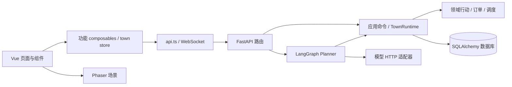
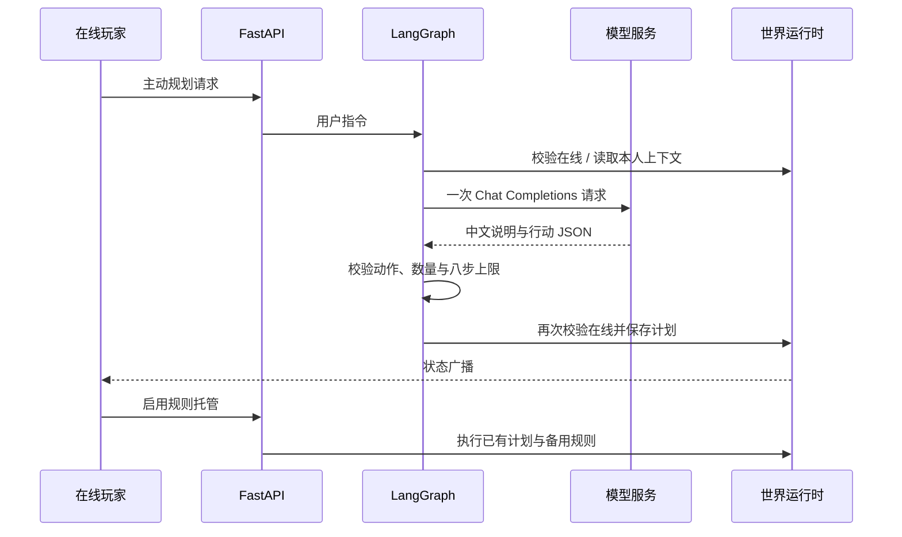

# v2 系统架构与工程边界

日期：2026-11-19。适用目录：`frontend/`、`backend/`、`scripts/`。选型依据：[ADR-003](../../adr/ADR-003-shared-town-v2.md)。

## 摘要

服务端拥有唯一世界事实，浏览器发送意图并显示结果。Vue 管理业务界面，Phaser 显示场景，领域模块决定行动结果，LangGraph 只负责生成待校验计划。模型不能直接改数据库或共享资产。

## 技术与依赖

| 层 | 技术 | 职责 |
| --- | --- | --- |
| 工作区 | Vue 3、TypeScript、Vite、Lucide | 页面、表单、会话与世界订阅 |
| 地图 | Phaser 3、原创 Canvas 贴图 | 摄像机、角色选择、逐帧动画、路径显示 |
| 接口 | FastAPI、Pydantic、WebSocket | 参数与身份、HTTP 命令、共享状态广播 |
| 应用层 | Python 服务命令、TownRuntime | 编排、互斥事务、时钟、在线租约、请求取消 |
| 领域层 | Python 纯数据规则 | 行动、托管、订单、资金/物资检查 |
| AI | LangGraph、HTTPX | 构造上下文、调用兼容接口、结构校验、写入计划 |
| 存储 | SQLAlchemy、SQLite WAL | 世界、用户、会话、事件、留言、模型配置与归档 |

Python 依赖由 `backend/requirements.lock` 固定，前端由 `frontend/package-lock.json` 固定。PostgreSQL 驱动与 Compose 配方已提供，当前验收仍为 SQLite。

## 代码依赖方向

- `views/` 负责展示，功能状态分别放在 `useAgent`、`useMessages`、`useArchives`、`useReports`、`useProgress`；`stores/town.ts` 负责会话、订阅和页面编排。
- `domain/plans.py`实现八步队列的追加、旧值比较编辑、有限执行完成/失败状态转换；`services/commands.py`在世界事务内调用。`PlanQueue.vue`与`usePlanQueue.ts`提供队列排序/删除，AI工作区保存草稿也做旧值比较，避免覆盖已执行或新加入的步骤。
- `TownJourney.vue`展示本人行程、预计步行时间和暂停的计划；`RecipeBook.vue`从catalog读取配方与材料来源；`game/motion.ts`提供路径距离与已走路段匹配纯函数，Vue和Phaser复用。它们不写世界状态、不调用模型。
- `TownMap.vue` 管生命周期与设备像素密度；`game/TownScene.ts` 编排相机和地点交互；`ResidentLayer.ts` 管路径插值、四向行走和真实结果浮字；`Atmosphere.ts` 管环境动态。`game/art/` 按地形、建筑、人物和绘制工具拆分原创美术。地图不得计算奖励、扣款或访问模型。
- 设施坐标、可执行动作、市场价格与时钟间隔通过 `/api/catalog` 提供给前端，避免业务界面和地图各自硬编码不同的规则。
- `api/` 按认证、档案、世界、订单、消息、AI、归档、实时连接分文件；世界变更统一进入运行时事务。
- `services/commands.py` 实现接管、计划和规则命令；`domain/` 只处理字典状态，不依赖 FastAPI、SQLAlchemy、网络或 Phaser。
- `ai/provider.py` 只处理协议/连接/用量；`ai/planner.py` 负责图流程和计划写入，不把 HTTP 细节混入领域层。
- `engine.py` 与 `db.py` 是兼容导出入口，保留已有测试引用，不作为新业务聚集地。

不先制造大量空目录或通用框架。单个模块承担第二种职责、跨层依赖或修改经常互相干扰时继续拆分；代码行数不是增加抽象的理由。

## 一次行动如何完成

1. 浏览器提交 `/api/me/action`，身份从登录会话取得，客户端不能指定其他角色。
2. 应用命令取消本人待处理模型请求，切换本人控制，清除旧任务，创建新路线。
3. `TownRuntime.mutate` 加锁后用 `asyncio.to_thread` 执行读取/复制、命令、不变量校验和提交；取消调用也先等待工作线程结束，避免两个事务并行越过锁。
4. 世界 revision 与事件在同一数据库事务提交；异常回滚，不广播成功状态。
5. 时钟每 2 秒运行一次，每次推进 10 模拟分钟，服务端按 A* 网格路线前进；到达后验证资源并结算。
6. 提交后向每连接容量1队列放入最新状态，独立发送任务负责网络；新连接全量，protocol=2后续发送按版本增量，慢连接不占住世界锁。前端沿服务端已经经过的网格段连续绘制，动画约落后一个广播周期，不改变真实结算。

订单交付目前为即时命令。它与时钟共享同一把锁；两个玩家同时交付时只有一个成功，第二个看到订单已经结束。

## AI、在线与离线

- 每个用户最多一个未完成模型请求，10 秒调用间隔。配置与用量记录按用户隔离。
- 普通退出/连接关闭会取消本地 HTTP 任务；心跳每 5 秒发送，20 秒无有效租约即视为离线。多标签页中只要还有有效连接，该用户仍在线。
- 进入模型调用前、发送前、结果写入前都检查在线；手动接管或改计划也取消旧模型请求，防止迟到结果覆盖新决定。
- 离线调度模块不导入任何模型代码，只消费既有计划与规则，不会触发重新规划。
- 请求一旦到达第三方，取消本地连接无法保证第三方停止计费；系统不再续发调用。异常断网的识别存在心跳租约延迟。

## 数据与持久化

| 表 | 数据 |
| --- | --- |
| users / sessions | 六名成员、简介、目标、登录会话 |
| worlds | 单一世界 JSON、schema_version 与 revision |
| events | 行动与业务事实、前后资产、模拟 tick |
| messages | 发件人、收件人、内容、时间 |
| model_configs / model_calls | 各人连接配置、调用状态及服务商返回的用量 |
| archives | 本人的世界观察快照与个人资料 |
| departures | 最后离开时的 tick、余额、完成行动数 |
| world_samples | 每6tick的经济/物资汇总；最多240点，不加入实时广播 |

每次成功命令与 tick 均持久化。个人归档的“恢复”仅恢复自己的计划和规则，并切到本人控制，不回滚资产、他人状态或世界时间。服务器迁移需要同时保留数据库与模型配置加密密钥；本机默认数据在 `.local/`，不进入 Git。

数据库结构通过 Alembic 管理：`0001` 建立基线或接管已有表，`0002` 增加九项查询索引。启动时由 `bootstrap.initialize` 先升级结构，再执行领域层世界 JSON 的增量升级；这两个版本机制各自独立。基线接管检查必需字段和主键，不会覆盖旧行，也不自动修复任意历史 schema。发布前须用备份副本运行迁移和模型一致性检查；基础表降级禁止删除，索引版本可回退。详见[后端工程审查](backend-engineering.md)。

`infrastructure/async_io.py` 统一处理阻塞读写与取消：工作线程仍在提交时不能提前释放世界锁，成功提交的状态须发布后再传播取消。普通同步 API 由 FastAPI 工作线程执行；异步流程中的数据库调用显式转移到工作线程。`ai/records.py` 负责调用记录与状态，provider 只编排模型请求，不持数据库会话等待网络。

`infrastructure/http.py` 统一错误响应和请求关联；`api/health.py` 分开进程存活与数据库/世界时钟就绪。时钟连接校验失败纳入单轮异常处理，后续轮次继续重试。当前仍是单 worker 世界权威，不支持跨进程共享锁。

## 运行约束

必须一个后端 worker：锁、在线连接、世界时钟和模型请求表均在单进程。水平扩展需先引入跨进程锁/世界分片与消息总线，不能简单增加 workers。

服务停止时小镇不推进；当前没有离线时间追算。服务端归档具备远程部署的结构，但当前没有部署外部云服务。Compose 是候选部署方式，不是已验收环境。

## 检查与扩展

前端构建启用 strict、未使用变量检查；后端用 Ruff 与 pytest；端到端联调用 Playwright 六个独立上下文。CI 本地配置覆盖依赖安装、文档、探针、lint、新旧测试与构建；云端 CI 尚未触发，因为本轮未推送。

新动作需更新 `catalog`、`domain/actions`、输入/模型允许动作与前端文案，并增加对真实业务边界的验证。新业务系统先写 Spec，再落领域服务与接口；不把计算塞进 Vue 或场景 update。验收与证据见[验证记录](verification.md)。

## 本轮游戏化扩展

`domain/progression.py` 只消费成功结算结果，在原世界事务内更新 `agent.progress`（xp、metrics、badges），不发钱、不调用模型。订单交付也在同一事务登记成长；重复交付被订单状态挡住，不能重复领取。`/api/catalog` 返回六项目标定义，`useProgress` 派生展示等级与目标状态，`TownJournal` 展示进度，客户端不提交成长数值。启动时只为缺少字段的旧居民补零值，迁移重复执行不变；不推算无法证明的历史分项进度。

指定交流仍使用 `social` 行动：服务端验证目标是另一位居民，按发起时的位置寻路，到达后重新检查距离，再原子更新双方关系。前端仅展示和发出意图；AI 可在公开邻居ID、名字和坐标上下文中选择目标，依然不能控制对方。留言仍为独立业务，不把固定规则冒充大模型对话。

高清场景使用3倍采样原创贴图，Phaser实际画布宽高为DOM尺寸乘设备像素比（上限2），CSS显示尺寸保持不变。Phaser 3.90的Canvas文字分辨率在创建Text时设置，避免只改文字画布却未同步纹理源分辨率造成的标签变大问题。日夜来自现有tick，不改变结算时钟；昼夜效果、路线和小地图可分别控制。

## 可靠性与审查整改

客户端 `api.ts` 负责有限超时与取消，`realtime/connection.ts` 管单连接生命周期、指数退避和心跳，`realtime/protocol.ts` 负责结构与版本校验；store只应用合法状态。每连接基线独立，重同步清除其基线后发送全量。`runtime` 一次事务只读取一次广播快照，再按身份隐藏他人计划与规则；仍有整世界JSON写入和个性化复制成本，尚未引入AOI或分片。

`domain/economy.py`负责午夜结余维护金，`balance.py`从`backend/config/game.json`验证加载规则；`services/history.py`在同一事务写独立采样表。`ReportDashboard`组合三类图表。`telemetry.py`输出基础指标与JSON日志，备份容器只负责数据库归档。处理矩阵见[审查响应](review-response.md)，命令和未验证范围见[运行说明](operations.md)。

## 地图扩展的共享契约

地形/桥/道路/入口/建筑统一来自`shared/world-map.json`，Python与TypeScript分别通过world_map/world-layout适配。碰撞和路线仍由后端判定，前端仅显示相机区域与服务端路径。布局版本升级通过domain/migration重定位新障碍内的居民并重算当前行程，不回滚资产。生产配方与食物效果集中在domain/recipes，catalog发布相同的输入输出数据。详细行为和新资源链见[地图扩展](map-expansion.md)。

## 地图版本3与社区供应

`domain/deliveries.py`提供六种物资委托，在到达交付站后的同一事务中检查日期、每日上限、原料和预算，再更新背包、个人余额、公库与供应统计。`supply`成长事件独立于玩家订单的`delivery`，避免误解锁合作目标。`DeliveryBoard`只展示状态并发出行动；增量同步校验允许新的供应统计及居民交付日志。新街区地块和专用建筑绘制拆分在`art/districts.ts`与`art/industry.ts`，地图入口和碰撞仍共享几何定义。详见[街区扩展](district-expansion.md)。

## 场景材质与光照

`art/materials`只负责静态材质和阴影；`art/building-shell`负责建筑壳体；路灯几何由`art/lighting-props`同时提供给静态绘制和环境层。`lighting`从世界tick纯计算连续的夜色、暖色和灯光强度；`Atmosphere`只更新表现，复用光晕贴图，不修改世界。技术范围、减少动态效果处理和像素验收见[渲染说明](rendering.md)。
