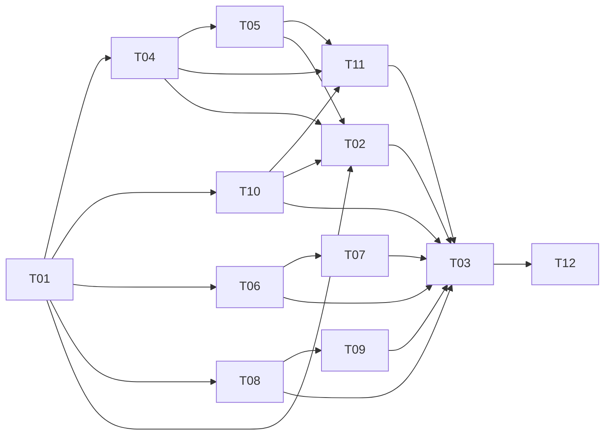

# 雾河镇 MVP1 Plan

## 1. 范围
只拆MVP1五模块。任务遵循“一个任务一个可评审PR”，核心实现每项绑定2条AC；T01绑定架构/数据契约，T12绑定DEMO-01集成交付物。测试随功能任务完成，不把所有测试推迟到最后。

不拆AI对话、账号、多模板、历史模拟或玩家视角。第9周提交的是Plan，不是业务代码。12项任务、27人日估计不代表已完成工作；当前排期用相对工作日，不把课程周次硬对应未经确认的日历日期。

## 2. 任务表
| 任务ID | 对应spec/AC | 任务描述 | 负责人 | 分支名 | 依赖 | 验收标准 | 状态 |
| --- | --- | --- | --- | --- | --- | --- | --- |
| T01 | ADR-001, ADR-002 | 建立共享状态契约与初始化夹具 | 张果 | `feature/issue-7-schema` | 无 | 固定字段/种子/版本及30人初始夹具，资金总额1600；无DOM和网络依赖。 | This Week |
| T02 | M1-AC-01, M1-AC-02 | 实现世界初始化与原子时间控制 | 王崛 | `feature/issue-8-world-control` | T01、T04、T05、T10 | day=0起步；暂停可手动单步；忙/过期/异常全世界不变；参数错误不覆盖现有世界。 | Backlog |
| T03 | M1-AC-03, M1-AC-04 | 实现观察页面与一次短缺交互 | 张果 | `feature/issue-9-observer-ui` | T02、T06、T07、T08、T09、T10、T11 | 展示五个区域并消费应用结果；未知居民明确错误；短缺取floor(F*0.8)，重复拒绝；不在UI计算业务规则。 | Backlog |
| T04 | M2-AC-01, M2-AC-02 | 实现工作工资与食水消费规则 | 李展博 | `feature/issue-10-livelihood` | T01 | 工作20/19精力、工资不足、饥饿49/50、余额1/2、零粮水边界可核对。 | Backlog |
| T05 | M2-AC-03, M2-AC-04 | 实现广场关系与每日不变量检查 | 李展博 | `feature/issue-11-social-invariants` | T04 | 两人配对/容量10/关闭/上限100；固定输入30天稳定且资金守恒。 | Backlog |
| T06 | M3-AC-01, M3-AC-03 | 实现一名数字人物的加入与时点约束 | 孙祥 | `feature/issue-12-profile-import` | T01 | 默认resident、cash0、人口31；上限及投票关闭拒绝；同名依靠ID区分。 | Backlog |
| T07 | M3-AC-02, M3-AC-04 | 实现人物授权校验与安全文本展示适配 | 孙祥 | `feature/issue-13-profile-validation` | T06 | 16KiB、授权boolean、字段白名单、20码点与住宅校验；HTML文本不执行、不联网。 | Backlog |
| T08 | M4-AC-01, M4-AC-02 | 实现固定议案的立场快照与计票 | 钱俊昊 | `feature/issue-14-proposal-vote` | T01 | score10=499/500、平票、空名单、关闭重复等结果准确；每人恰好一票。 | Backlog |
| T09 | M4-AC-03, M4-AC-04 | 实现维修执行的资金与重复保护 | 钱俊昊 | `feature/issue-15-proposal-execution` | T08 | 119拒绝且events不变，120成功公库0；信任截断、外部支出列账；重复/故障无部分效果。 | Backlog |
| T10 | M5-AC-01, M5-AC-02 | 实现事件契约与快照等值恢复 | 姚富恩 | `feature/issue-16-snapshot-core` | T01 | 连续事件序号、完整字段；导出恢复不新增世界事件；schema/rule/scenario版本均1。 | Backlog |
| T11 | M5-AC-03, M5-AC-04 | 实现快照拒绝校验与续跑复现测试 | 姚富恩 | `test/issue-17-snapshot-validation` | T10、T04、T05 | 坏JSON、5MiB、缺字段、版本、负数、序号、引用分别拒绝；15+恢复+15等于30。 | Backlog |
| T12 | DEMO-01 | 完成单页集成与演示验收证据 | 王崛 | `test/issue-18-integration-demo` | T03 | 按演示脚本跑全链路，提供实际环境、30日结果、恢复对照、性能样本与缺陷清单；不以探针代替。 | Backlog |

分支中的{number}必须由真实GitHub Issue号替换；12项已发布为真实Issue；分支存在性以tasks.json的branchCreated为准。可直接发布的完整Issue正文见 [工单目录](issues/README.md)。

## 3. 依赖、关键路径与工期

按估计天数计算，关键路径 **T01(2) → T04(3) → T05(2) → T02(3) → T03(3) → T12(2) = 15个工作日**。T11在第9个工作日结束，早于T02第10日；因此T11不是关键路径。估计是逻辑最早完成时间，未包含评审等待/返工，建议预留20%缓冲；课程可用时间不足时先缩小范围或调整投入，不能写成必然按期完成。

可并行：T01合并后T04/T06/T08/T10；同文件修改顺序串行：T04→T05、T06→T07、T08→T09、T10→T11。T03只负责UI集成，不重新实现规则。T12依赖T03，而T03传递依赖所有模块，不跳过未完成后端/规则测试。

## 4. This Week
T01进入This Week，其余Backlog；当前课程文档任务另在交付检查表跟踪。用户已于2026-11-18授权启动正式开发。发布时创建五列：Backlog、This Week、In Progress、Review、Done，至少将T01排入This Week；未发生的开发不得放入Done。

## 5. 角色记录
| 周次 | Spec Owner | Reviewer | 开发 | 记录人 |
| --- | --- | --- | --- | --- |
| 第9周（建议） | 张果 | 王崛 | 全组，当前仅计划 | 姚富恩 |
| 第10周（建议） | 王崛 | 李展博 | 按任务负责人 | 孙祥 |
| 第11周（建议） | 李展博 | 张果 | 全组集成复测 | 钱俊昊 |

这是轮换计划，不是已发生的会议或贡献记录。人员不区分成果归属；每项PR仍需非作者评审以完成课程流程。
