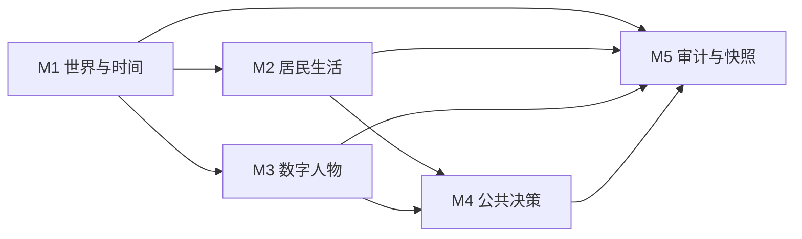

# 第 7 周计划书：雾河镇 MVP1 规格与冷启动

- 文档版本：v1.0
- 计划日期：2026-11-10
- 执行周期：2026-11-10 至 2026-11-16
- 本周性质：需求与规格周，不写业务代码
- 关联资料：`07 Spec：给AI的人机契约.pptx`、`context.md`、`spec/SRS.md`、`plans/phase-1.md`

## 1. 本周结论

本周不扩展“雾河镇”的页面功能，也不接入大模型。全组的任务是把当前可演示原型收敛成一份可由组员和 AI 正确执行的 MVP1 规格。

本周完成后，组员只读规格，应能回答以下问题：

1. MVP1 到底做到哪一步。
2. 第一版由哪些模块组成。
3. 每个模块由谁负责、依赖什么。
4. 每个用户故事如何验收。
5. 正常、边界和异常情况分别应产生什么可观察结果。
6. AI 只读模块规格时，是否会误解规则。

## 2. 项目定位与本周边界

“雾河镇”是一个围绕居民生活、资源生产、社交关系与公共决策的可交互模拟器。第一阶段先用确定性规则形成可解释的小镇运行闭环，再在后续版本验证人物导入、模型决策和历史分支。

本周不做：

- 实际编写或重构业务代码。
- 接入 AI API、角色对话或模型决策。
- 完成玩家附身模式。
- 导入真实历史数据或实现历史反事实。
- 注册登录、服务端数据库、多用户协作或在线同步。
- 战争、跨城镇、复杂供应链和完整国家治理。

现有 `index.html` 是可交互演示原型，可作为需求讨论的参考，但不能直接作为本周验收已经完成的证据。

## 3. MVP1 定义

### 3.1 一句话范围

> 在 30 人小镇中，创建者能够导入 1 位已获授权的数字人物，连续推进 30 个模拟日，经历一次轻度粮食短缺，完成一次维修老水井的公共决策，并从导出快照复现同一种子下的主要状态变化。

### 3.2 最短端到端演示路径

1. 创建者载入固定的“雾河镇·春旱”场景，场景包含 30 名居民、基础设施和初始库存。
2. 创建者导入 1 份已获授权的数字人物档案，档案补齐职业、住所和初始资源。
3. 创建者推进模拟时间，查看至少 1 位居民的工作、消费、社交或娱乐记录。
4. 创建者触发一次轻度粮食短缺，查看库存、居民需求、关系或公共事务受到的影响。
5. 创建者发起“维修老水井”决策，查看居民立场、投票结果、公库扣款和资源变化。
6. 创建者导出快照，然后重新导入，并确认种子、规则版本、主要资源和事件记录得到恢复。
7. 在相同配置、种子和规则版本下，主要状态变化可重复出现。

### 3.3 MVP1 成功语句

MVP1 通过时，以下结果必须同时成立：

- 小镇可以载入并连续推进至少 30 个模拟日。
- 居民每日行动能够改变至少 3 类状态，例如饥饿、精力、个人余额、关系或库存。
- 粮食短缺会形成可追踪的连锁影响，而不是只显示一条提示。
- 公共决策包含立场形成、计票、执行结果和状态变化。
- 1 位数字人物可以作为正式居民参与规则结算，而不只是出现在名册中。
- 快照可以恢复种子、规则版本、世界状态和事件时间线。
- 相同种子与配置重复运行时，关键结算结果一致。

## 4. MVP1 范围表

| 模块 | 是否进入 MVP1 | 端到端作用 | 负责人 | 主要依赖 |
| --- | --- | --- | --- | --- |
| M1 世界初始化、时间推进与观察界面 | 是 | 输入入口和运行控制 | 组长/集成负责人 | 无 |
| M2 居民生活、生计与社交 | 是 | 每日核心处理 | 居民系统负责人 | M1 |
| M3 授权数字人物接入 | 是 | 项目差异化输入 | 人物与隐私负责人 | M1、M2 |
| M4 公共议题与决策 | 是 | 社会冲突与公共结果 | 政治系统负责人 | M1、M2、M3 |
| M5 事件审计、快照与复现 | 是 | 输出证据和复盘 | 数据与测试负责人 | M1 至 M4 |
| 账号、服务端与多用户协作 | 否 | 后续在线版本 | 待定 | MVP2 |
| AI 对话与模型行动选择 | 否 | 后续智能体版本 | 待定 | MVP2 |
| 玩家附身接口 | 否 | 后续体验版本 | 待定 | MVP2 |
| 历史场景编辑器与反事实分支 | 否 | 后续研究版本 | 待定 | MVP3 |
| 战争、跨城镇与复杂外交 | 否 | 后续扩展 | 待定 | 未排期 |
| 自由地图编辑、复杂供应链 | 否 | 后续扩展 | 待定 | 未排期 |

责任人暂时以角色代替。组长需在开工前把实际姓名填入 `spec/mvp1-scope.md`，避免多人同时修改同一模块。

## 5. 模块拆分

### M1：世界初始化、时间推进与观察界面

负责固定场景载入、时间单位、暂停与单步推进、小镇总览、居民详情和时间线显示。

核心输出：

- `spec/module-01-world-time.md`
- Town、Facility、Resource 和运行状态的字段约定
- 时间推进顺序与单步结算边界

必须回答：

- 一天内先计算环境、居民还是设施。
- 暂停时哪些按钮仍可操作。
- 玩家触发事件后何时开始影响世界状态。

### M2：居民生活、生计与社交

负责居民需求、精力、饥饿、职业、生产、消费、个人余额、关系变化和广场社交。

核心输出：

- `spec/module-02-resident-life.md`
- 居民行动顺序和数值更新公式
- 工作、进食、社交和娱乐的可观察结果

必须回答：

- 食物不足时谁先得到食物。
- 精力耗尽后居民还能做什么。
- 社交关系变化是否必须附带具体事件。
- 广场活动对精力、关系和事件记录产生什么影响。

### M3：授权数字人物接入

负责导入 1 份获授权的结构化人物档案，分配正式居民身份，并确保其参与统一规则结算。

核心输出：

- `spec/module-03-digital-resident.md`
- 人物导入字段白名单
- 授权确认、校验失败和删除恢复规则

必须回答：

- 哪些字段必填，哪些字段可以缺省。
- 人物缺少职业或住所时如何补齐。
- 未确认授权时系统是否允许导入。
- 同名人物、重复 ID 和非法数值如何处理。
- 个人信息是否进入事件日志或导出快照。

### M4：公共议题与决策

负责“维修老水井”这一固定 MVP1 议题的提出、居民立场、计票、执行和结果记录。

核心输出：

- `spec/module-04-public-decision.md`
- 居民立场生成规则
- 公库扣款、资源变化和信任变化的结算顺序

必须回答：

- 哪些居民具有表决资格。
- 支持票和反对票如何由需求、关系和资源共同决定。
- 公库不足时是取消、延期还是缩小维修范围。
- 一个议题在同一时间线中能否重复执行。

### M5：事件审计、快照与复现

负责事件时间线、状态变更证据、JSON 快照、版本信息和确定性恢复。

核心输出：

- `spec/module-05-audit-snapshot.md`
- 事件记录字段
- 快照结构和版本迁移策略

必须回答：

- 每次行动必须记录哪些主体、规则、结果和影响对象。
- 随机种子、规则版本和场景版本保存在哪里。
- 导入旧快照或损坏快照时如何失败且不破坏当前状态。
- 为什么导出的种子没有被载入时，复现应被判定为失败。

## 6. 模块依赖



M5 最后完成不等于最后才开始。数据与测试负责人从第一天起就要维护事件字段、版本号和验收样例，其余模块按约定写入。

## 7. 每个模块 Spec 的固定结构

所有 `spec/module-*.md` 必须包含以下七章：

| 章节 | 本项目的写法要求 |
| --- | --- |
| 摘要 | 模块做什么，位于端到端路径的哪一步 |
| 用户故事 | 作为角色，我想要行为，以便价值 |
| 验收标准 AC | 全部使用 Given/When/Then，可判定 |
| 功能需求 | 系统具体如何计算、校验、记录和展示 |
| 非功能需求 | 可复现、可解释、隐私、性能和恢复要求 |
| 边界与异常 | 集中列出触发条件、可观察结果和错误标识 |
| Non-Goals | 明确本模块在 MVP1 不做什么 |

### 7.1 用户故事粒度

一个用户故事应当对应一个可独立验收的操作或场景，通常包含 1 至 3 条 AC。出现 5 条以上 AC 时必须拆分；如果只是某个价值点中的一个步骤，应并入功能需求。

项目示例：

- “作为创建者，我想载入固定的春旱场景，以便每次演示都从同一初始状态开始。”
- “作为观察者，我想查看一位居民的工作与消费记录，以便理解库存和余额如何变化。”
- “作为数字人物本人，我想在导入前审阅获准进入模拟的字段，以便控制个人资料的公开范围。”
- “作为观察者，我想看到公共议题的表决依据，以便判断支持票和反对票为何产生。”

### 7.2 验收标准

所有 AC 使用以下格式：

```text
Given [前置状态]
When [用户操作或系统事件]
Then [可观察结果、状态变化和错误标识]
```

模块至少包含 3 条 AC，每个用户故事至少包含 1 条 AC。模块整体必须覆盖正常、边界和异常三类情况。

项目示例：

- Given 小镇有 30 名居民且公库不少于 120 镇币，When 创建者通过维修水井议案，Then 公库减少 120 镇币、清水库存增加指定值，并新增一条包含计票结果的决策事件。
- Given 公库只有 119 镇币，When 创建者执行维修水井议案，Then 世界状态保持不变，界面显示 `INSUFFICIENT_TREASURY`，事件时间线不记录“执行成功”。
- Given 快照的文件版本高于当前规则支持版本，When 创建者尝试导入，Then 当前状态保持不变，界面显示 `SNAPSHOT_VERSION_UNSUPPORTED`。

本周项目主要使用应用内错误标识，不为了模仿图书馆案例而虚构 HTTP 状态码。如果后续引入 HTTP API，再由对应模块补充 HTTP 状态码。

### 7.3 边界与异常

边界与异常表至少包含：

| 场景 | 预期行为 | 错误标识或结果 | 对应 AC |
| --- | --- | --- | --- |
| 输入示例 | 可观察结果 | 稳定错误标识或无错误 | AC 编号 |

优先覆盖：

- 人口为 0、20、30 和超过上限。
- 公库刚好足够、差 1 单位资金。
- 粮食库存为 0、接近耗尽、刚恢复充足。
- 同一议题重复执行。
- 同一快照重复导入。
- 导入对象缺少授权、缺少必填字段或数值越界。
- 旧版本快照、损坏 JSON 和未知字段。
- 相同种子重复运行。

## 8. 本周交付物

| 交付物 | 内容要求 | 主责 | 复核 |
| --- | --- | --- | --- |
| `spec/mvp1-scope.md` | MVP1 范围、端到端路径、模块负责人、依赖和 Non-Goals | 组长/集成负责人 | 数据与测试负责人 |
| `spec/module-01-world-time.md` | M1 七章规格 | 组长/集成负责人 | 政治系统负责人 |
| `spec/module-02-resident-life.md` | M2 七章规格 | 居民系统负责人 | 数据与测试负责人 |
| `spec/module-03-digital-resident.md` | M3 七章规格 | 人物与隐私负责人 | 组长/集成负责人 |
| `spec/module-04-public-decision.md` | M4 七章规格 | 政治系统负责人 | 居民系统负责人 |
| `spec/module-05-audit-snapshot.md` | M5 七章规格 | 数据与测试负责人 | 人物与隐私负责人 |
| `docs/test/cold-start-01.md` | 全新会话、只喂模块规格、记录原始问题、回答摘要、偏差和修正 | 数据与测试负责人 | 全组确认 |
| 对应 GitHub Issue 与 PR | 每个模块一个 Issue，PR 关联 Issue 并列出验证方式 | 各模块负责人 | 组长 |

建议把 M4 作为第一次冷启动对象，因为“谁投票、如何计票、资金不足怎么办”最容易出现理解偏差。若时间允许，再对 M3 和 M5 各做一次补充校验。

## 9. 七天执行安排

| 日期 | 工作 | 产出 | 完成门槛 |
| --- | --- | --- | --- |
| 11 月 10 日 | 组会确认 MVP1 成功语句、模块和负责人 | Issue 清单、责任人表 | 每个模块只有一个主责人，Non-Goals 初稿完成 |
| 11 月 11 日 | 各模块负责人完成用户故事、功能需求和数据字段 | 五份模块 Spec 初稿 | 每个故事能对应具体角色和可观察价值 |
| 11 月 12 日 | 交叉评审并编写 AC、边界与异常表 | 交叉评审记录、AC 修订稿 | 每个模块至少 3 条 AC，正常、边界、异常均覆盖 |
| 11 月 13 日 | 冻结 MVP1 范围和字段命名 | `mvp1-scope.md`、Spec 基线 | 不出现“可选但没写是否 MVP1”的模块 |
| 11 月 14 日 | 用全新会话完成第一次冷启动 | `cold-start-01.md` | 只输入单个模块 Spec，不输入 context 或口头解释 |
| 11 月 15 日 | 根据偏差修改 Spec，复跑或复核 | Spec 修订记录 | 不通过改 prompt 掩盖规格问题 |
| 11 月 16 日 | 全组一致性检查、提交 PR、准备课堂说明 | 合并前的完整交付 | 文档链接、需求、字段、AC 和范围一致 |

如果课程实际截止日期不同，只调整日期，不压缩交叉评审和冷启动两个环节。

## 10. 冷启动执行计划

### 10.1 输入

第一次冷启动只输入：

```text
spec/module-04-public-decision.md
```

不输入 `context.md`、现有代码、对话历史或额外解释。

### 10.2 操作步骤

1. 新开一个没有任何历史上下文的 AI 会话。
2. 只提交 M4 模块 Spec。
3. 提出中立问题：“公库只有 119 镇币时，创建者执行维修老水井议案，系统应该发生什么？为什么？”
4. 原样保存问题、AI 回答摘要和遗漏点。
5. 对比 AI 回答与 Spec 的预期结果。
6. 将偏差归因到具体章节或 AC。
7. 修改 Spec，不修改提问 prompt。
8. 如规则发生实质变化，再开全新会话复测一次。

### 10.3 通过条件

- AI 能准确回答公库不足时不执行扣款、资源不增加。
- AI 能引用具体 AC 或功能需求说明原因。
- AI 能给出稳定且具体的失败标识。
- AI 不自行补出“向居民追加征税”或“延期后自动执行”等未定义行为。

未达到条件时，第一次冷启动记为“需修订”，不能记录为“通过”。

## 11. 分工与协作

### 11.1 六个能力位

| 能力位 | 本周职责 |
| --- | --- |
| 组长/集成 | MVP1 范围、接口边界、跨模块一致性、PR 合并 |
| 世界与时间负责人 | M1，统一时间推进和观察状态 |
| 居民系统负责人 | M2，统一需求、生计、社交和娱乐规则 |
| 人物与隐私负责人 | M3，字段白名单、授权和资料最小化 |
| 政治系统负责人 | M4，议题、立场、计票与执行 |
| 数据与测试负责人 | M5、AC 质量抽查、快照复现和冷启动记录 |

### 11.2 协作纪律

- 每个模块先建 Issue，再建短期分支。
- 一个 PR 只处理一个模块或一次范围调整。
- AC 和功能需求必须由非作者复核。
- 文档里的模块名、字段名、错误标识和事件名必须统一。
- 冷启动记录必须是实际回答，不能由作者自行编写“预想回答”。
- 本周不顺手修改业务代码，避免规格与实现同时变化。

## 12. 质量门槛

### 12.1 范围门槛

- MVP1 只有一个明确的端到端演示路径。
- 每个候选模块均明确标记“是”或“否”。
- 所有“否”项写明归入 MVP2、MVP3 或未排期。
- 任何模块都不能同时由两个人主责。

### 12.2 Spec 门槛

- 五份模块文件均包含七章。
- 每个用户故事都有角色、行为和价值。
- 模块至少 3 条 AC，每个故事至少 1 条 AC。
- AC 使用 Given/When/Then，且可被另一位组员判断通过或不通过。
- 边界与异常集中列出，每个关键场景对应至少一条 AC。
- 非功能需求覆盖复现、审计、隐私、错误恢复和成本边界。

### 12.3 冷启动门槛

- 使用全新会话。
- 只喂单个模块 Spec。
- 保留实际回答摘要和偏差。
- 修正记录能定位到 Spec 的具体章节。
- 作者不能用额外解释替 AI 补全遗漏。

## 13. 风险与应对

| 风险 | 后果 | 应对 |
| --- | --- | --- |
| 把 `plans/phase-1.md` 的全部内容当作 MVP1 | 范围过大，模块和 AC 失控 | 以 `mvp1-scope.md` 为本周唯一范围基线 |
| 数字人物导入扩大到主页抓取或真实资料 | 隐私风险、工期失控 | MVP1 只接受授权后的结构化 JSON |
| 为了“更像 AI 项目”提前加入模型调用 | 本周评分目标偏航 | 本周只定义模型未来必须遵守的规则接口 |
| 五个模块共用一个文件 | 冲突多、AI 理解范围混乱 | 一个模块一个 Spec，M5 统一字段 |
| 冷启动用已有会话 | 测出的是上下文能力，不是 Spec 能力 | 新会话、只喂 Spec、保留记录 |
| 只写正常路径 | AI 自行猜测异常行为 | 每个模块必须有边界异常表和对应 AC |
| 规格继续引用现有页面的硬编码值 | 页面缺陷被写成正式规则 | 数值只能作为待确认默认值，并写入配置或验收条件 |
| 30 个模拟日与最短路径混淆 | 范围过大或稳定性定义不清 | 7 步是最短用户路径，30 日是稳定性指标 |

## 14. 完成定义

本周工作只有在以下条件全部满足后才算完成：

- `spec/mvp1-scope.md` 已明确范围、模块、负责人、依赖和 Non-Goals。
- 五个 MVP1 模块各自拥有独立、七章完整的 Spec。
- 用户故事与功能需求对应，AC 可测试且覆盖关键边界。
- 至少完成一次真实的 M4 冷启动校验。
- 冷启动发现的问题已经回写 Spec，而不是停留在口头说明。
- 文档之间没有模块名、字段名和范围冲突。
- PR 已关联 Issue，并由非作者完成范围和 AC 复核。
- 本周没有用业务代码进展替代规格交付。

## 15. 课后检查清单

- [ ] MVP1 成功语句已由全组确认。
- [ ] 每个 MVP1 模块已确定唯一负责人。
- [ ] `spec/mvp1-scope.md` 已完成。
- [ ] 五份 `spec/module-*.md` 已完成。
- [ ] 每个故事至少 1 条 GWT 格式 AC。
- [ ] 每个模块至少 3 条 AC。
- [ ] 边界与异常表已对应 AC。
- [ ] 数字人物字段和授权规则已明确。
- [ ] 快照已包含种子、规则版本和场景版本。
- [ ] 已在全新会话完成冷启动。
- [ ] 冷启动偏差已回写 Spec。
- [ ] 全体组员可复述 MVP1 最短演示路径。
- [ ] PR 已关联 Issue 并完成交叉评审。
